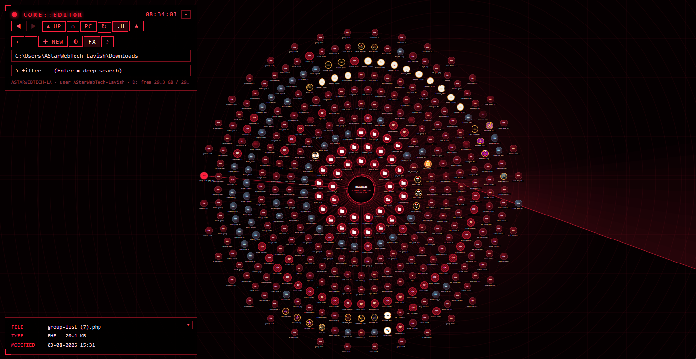
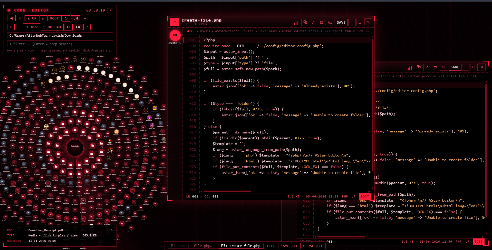
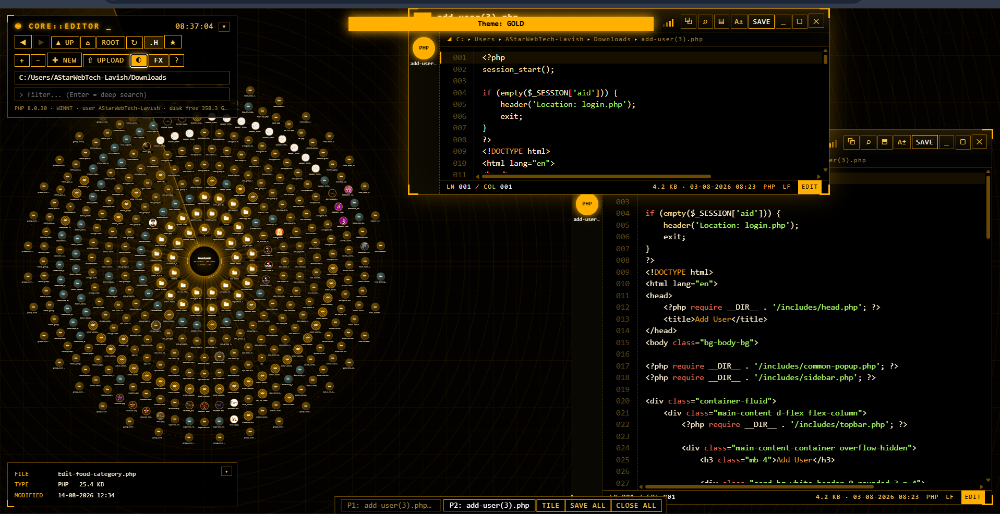
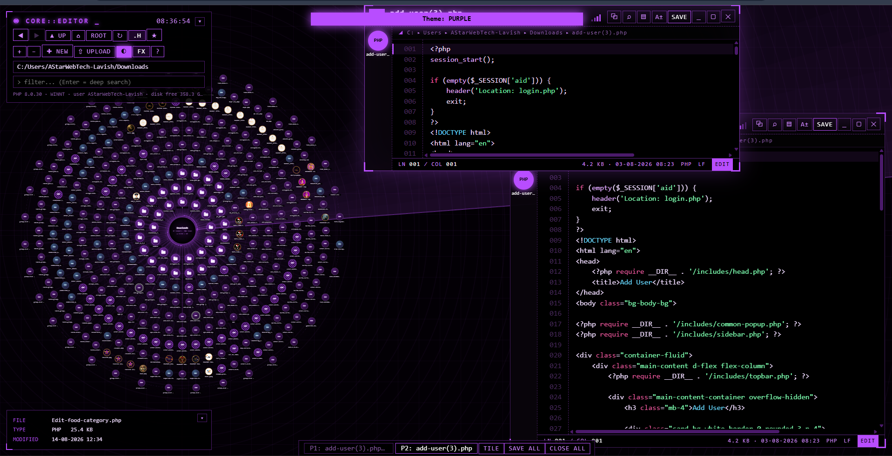
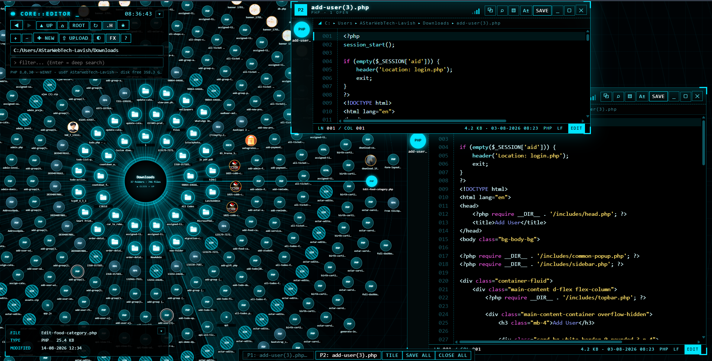
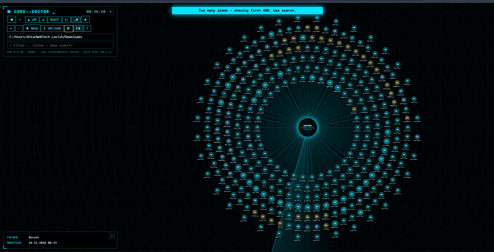
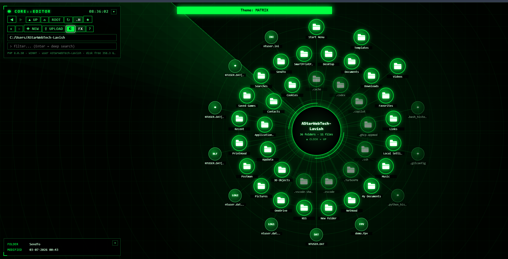

# GHOSTSHELL

A futuristic, cyberpunk-style file manager and code workspace with a circular interface, animated visual effects, multiple colour themes, and a browser-based PHP edition.

> **Project note:** The supplied PHP file identifies its interface internally as `CORE::EDITOR`. This README uses the project folder name, **GHOSTSHELL**.

## Features

- Visual file and folder navigation through a circular interface
- Multiple colour themes using the included PNG preview assets
- Optional visual effects and zoom controls
- Create files and folders, with starter templates for HTML, PHP, JavaScript, CSS, Python, JSON, Markdown and text
- Open and edit supported text files
- Upload, download, rename, duplicate, copy, move and delete files
- Search within folders and browse ZIP archives like folders
- ZIP extraction, compression and folder download
- Preview supported images, audio, video and PDF files
- Multi-window editor workspace with draggable/resizable panels
- Keyboard shortcuts for common actions


## Screenshots / theme previews

The repository includes these theme preview images:

| Theme | Preview |
|---|---|
  |
  |
  |
  |
  |
  |
  |

## Run the PHP version

The PHP version requires a web server with PHP support.

1. Install PHP or use a local server package such as XAMPP.
2. Copy the project folder into the server's web root (for example, `htdocs` in XAMPP).
3. Open the PHP file through your local server, for example:

   ```text
   http://localhost/GHOSTSHELL/GHOSTSHELL.php
   ```

4. Keep the PNG files in the same folder as the PHP file so the theme assets remain available.

## Security configuration — read before deployment

**Do not upload the PHP version to a public server with its default settings.** In the supplied file, both settings are empty:

```php
$PASSWORD = '';
$ROOT     = '';
```

An empty password disables the login screen, and an empty root setting allows browsing across the server filesystem. Before deploying:

- Set a strong, unique `$PASSWORD`.
- Set `$ROOT` to the one specific directory the tool is allowed to manage.
- Use HTTPS.
- Keep the tool private and restrict access to trusted users/IPs where possible.
- Do not expose it on a production website unless you have reviewed and secured every file operation.

The PHP version can create, edit, upload, move and delete files. Treat it as a powerful server administration tool, not as a harmless public webpage.

## Requirements

- **PHP version:** A PHP-enabled web server. ZIP features require the PHP `ZipArchive` extension. Image thumbnail generation may use the GD extension.
- **Windows HTA version:** Windows with the HTML Application host (`mshta.exe`). Some Windows versions or security policies may block HTA files.

## Usage tips

- Use the top control panel for navigation, search, upload, theme, effects and help.
- Click a folder circle to open it; click the centre to move to the parent folder.
- Right-click an item for its context menu.
- Use the Help panel inside the app for the complete shortcut list.

## Keyboard shortcuts

| Shortcut | Action |
|---|---|
| `Alt + Left` / `Alt + Right` | Back / forward |
| `Backspace` | Parent folder |
| `F5` | Refresh |
| `Ctrl + N` | Create file or folder |
| `Ctrl + S` | Save current file |
| `Ctrl + Shift + S` | Save all |
| `Ctrl + F` | Find / replace in the editor |
| `Ctrl + G` | Go to line |
| `Ctrl + D` | Duplicate line |
| `Ctrl + /` | Toggle comment |
| `Ctrl + Mouse Wheel` | Change editor font size |
| `Esc` | Minimize active window / close relevant panels |

## License

No license file was included with the supplied project. Add a `LICENSE` file before presenting this repository as open source, and choose a license that matches how you want others to use the project.
